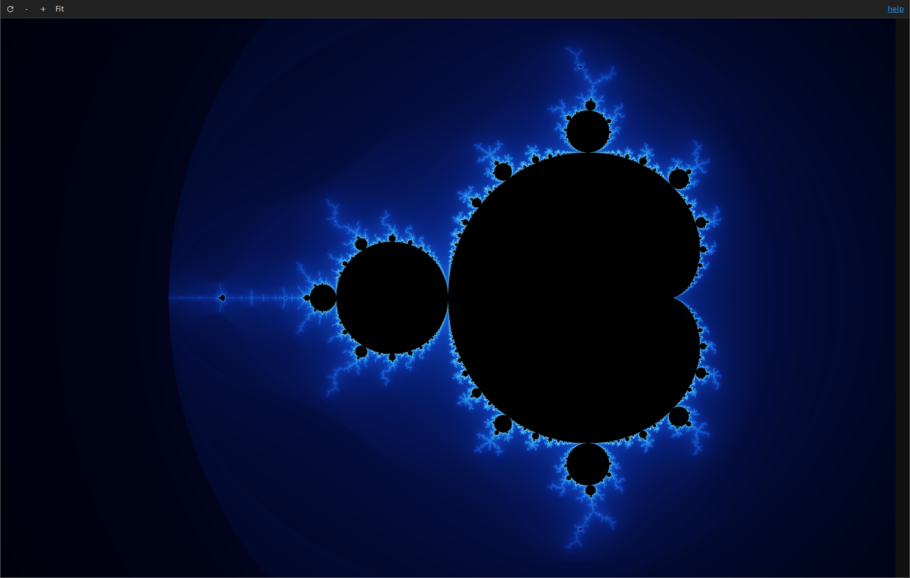
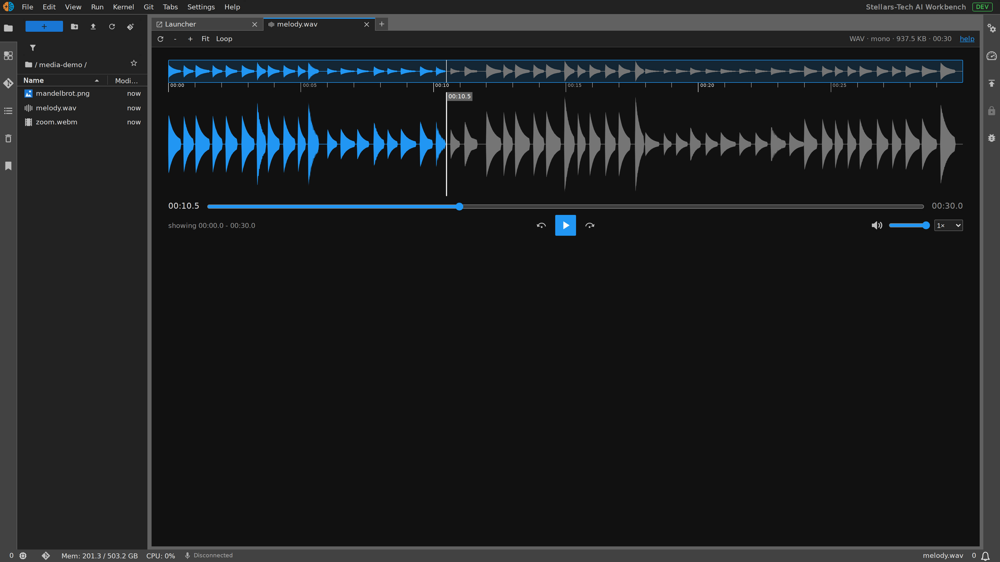
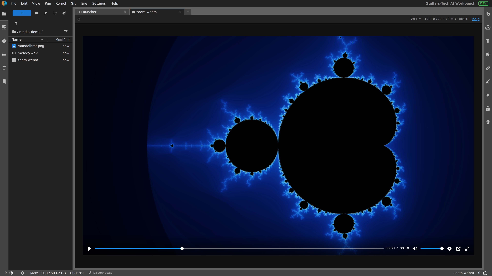
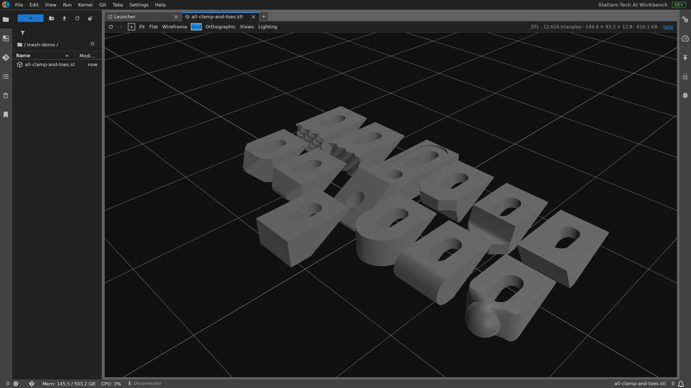

# jupyterlab_advanced_image_viewer_extension

[](https://github.com/stellarshenson/jupyterlab_advanced_image_viewer_extension/actions/workflows/build.yml)
[](https://www.npmjs.com/package/@stellarshenson/jupyterlab-advanced-image-viewer-extension)
[](https://pypi.org/project/jupyterlab-advanced-image-viewer-extension/)
[](https://pepy.tech/project/jupyterlab-advanced-image-viewer-extension)
[](https://jupyterlab.readthedocs.io/en/stable/)
[](https://kolomolo.com)
[](https://www.paypal.com/donate/?hosted_button_id=B4KPBJDLLXTSA)

A JupyterLab 4 extension that makes the built-in image viewer interactive and adds audio, video and mesh viewers. Images open fitted to the panel just like the stock viewer, then you can zoom with the wheel, pan by dragging, and step through a folder of images with the arrow keys - all in a single viewer tab.



The viewer toolbar adds zoom in / out / fit controls and a `help` link that lists every keybinding.

## Features

- **Fit to screen** - every image opens scaled to fit the panel (same result as the stock viewer), and reset returns to that fit
- **Wheel zoom** - scroll to zoom in and out, anchored at the cursor; zoom out as far as you like
- **Drag to pan** - hold and drag to move the image at any zoom; the image can touch a viewport border but never leave it, the grab cursor is always available, and Fit recenters
- **Toolbar controls** - zoom in, zoom out, and reset-to-fit buttons on the viewer toolbar
- **Arrow-key navigation** - Left and Right open the previous and next image in the same folder, in the order the file browser lists them, advancing within one viewer instead of opening new tabs
- **Copy to clipboard** - right-click a raster image (PNG/JPG/…) and choose "Copy to Clipboard" to copy it as PNG to the system clipboard
- **Refresh** - a toolbar refresh button reloads the image from disk, the same control the HTML viewer provides
- **WebP and AVIF support** - `.webp` and `.avif` files open in the image viewer with every feature above; stock JupyterLab does not open them and shows a File Load Error

## Audio and video viewers

Audio files open in a waveform player built on wavesurfer.js and video files in a Plyr player. The extension disables the stock JupyterLab audio and video viewers, so a double click on a media file opens these instead.




- **Audio controls** - under the waveform, a time row shows the played time, a seek slider over the whole file and the file length; a control row below it shows the range the waveform shows at the left, holds back 5 s, play/pause and forward 5 s in the centre, and mute, a volume slider and a speed choice of 0.5x to 2x at the right. The toolbar holds waveform zoom with - / + / Fit and Loop. The waveform adds an overview strip that seeks anywhere in the file, the time under the mouse, and a drag-marked loop region of at least 1 s. Volume, mute and speed carry to the next audio file and across a page reload, as in the video viewer
- **Video controls** - play/pause, a seek bar, the current time, mute and volume, a speed menu, picture in picture and full screen, in a player fitted to the panel with the aspect ratio kept
- **Keys in a focused media tab** - Space plays and pauses, Left and Right seek 5 s, and Page Up / Page Down open the previous and next file of the same kind in the folder, in the order the file browser lists them (the folder navigation setting turns this off)
- **Help dialog** - a `help` link in each media toolbar lists the keys and the waveform gestures
- **File details** - the toolbar shows the format, the size and the duration, plus the channel count for audio and the frame size for video
- **100 MB limit** - a file up to 100 MB is downloaded once from its file URL and played from that copy, so seeking works on a server without byte ranges; above 100 MB either file plays from its URL, so seeking there needs a server that serves byte ranges. Above 100 MB the extension's server part computes the audio waveform with PyAV for AAC, FLAC, M4A, MP3, OGG, OPUS and WAV files, so the server part must be enabled; the install enables it, and `jupyter server extension list` shows it. The server keeps each waveform in the user cache folder (`~/.cache/jupyterlab_advanced_image_viewer_extension`, at most 1 GiB), so the next open of an unchanged file draws at once, also after a server restart. While the server computes, a spinner stands in the waveform's place and the file already plays. Without a waveform the time row with its seek slider and the control row stay

## Mesh viewer

Mesh files open in a 3D viewer built on three.js, with STEP read by occt-import-js. The extension registers the mesh file types, so a double click on a mesh file opens this viewer.



- **Formats** - STL, PLY, OBJ, 3MF, GLB and STEP
- **Controls** - hold the left button to orbit, the right button to pan, and the wheel to zoom at the cursor; Reload reads the file again and keeps the camera, - / + / Fit zoom and frame the model, Flat and Wireframe switch the shading, Grid shows the ground grid, Orthographic switches the projection, Views picks a standard view and Lighting picks a lighting style
- **Standard views** - Front, Back, Right, Left, Top, Bottom and the four isometric corners, one at a time; a view is not carried to the next file
- **Lighting styles** - Studio (the default), Neutral and Three-point
- **Grid** - off by default; its lines are drawn in theme colours that reach 3:1 against the panel
- **Projection** - perspective by default; the Orthographic toggle keeps the model the same size and centred
- **Read-out** - the toolbar shows the format, the triangle count, the dimensions and the size
- **Keys in a focused mesh tab** - Page Up / Page Down open the previous and next mesh file in the folder, in the order the file browser lists them (the folder navigation setting turns this off)
- **Help dialog** - a `help` link in the mesh toolbar lists the controls
- **1 GiB limit** - a file up to 1 GiB is downloaded and shown; above 1 GiB the file is not downloaded and the viewer says so
- **STEP files** - occt-import-js reads them under LGPL-2.1 in a Web Worker; the WASM file ships in the wheel, and no request leaves the lab host

## Requirements

- JupyterLab >= 4.6
- Python >= 3.12

## Install

To install the extension, execute:

```bash
pip install jupyterlab_advanced_image_viewer_extension
```

## Uninstall

To remove the extension, execute:

```bash
pip uninstall jupyterlab_advanced_image_viewer_extension
```
