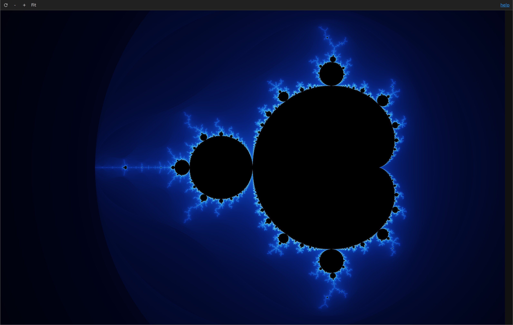
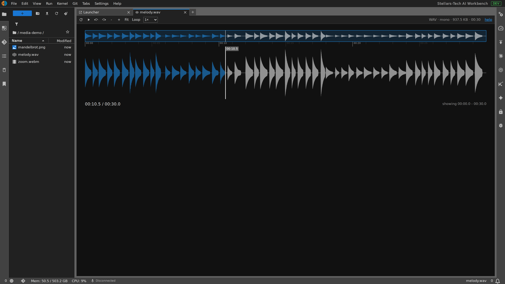
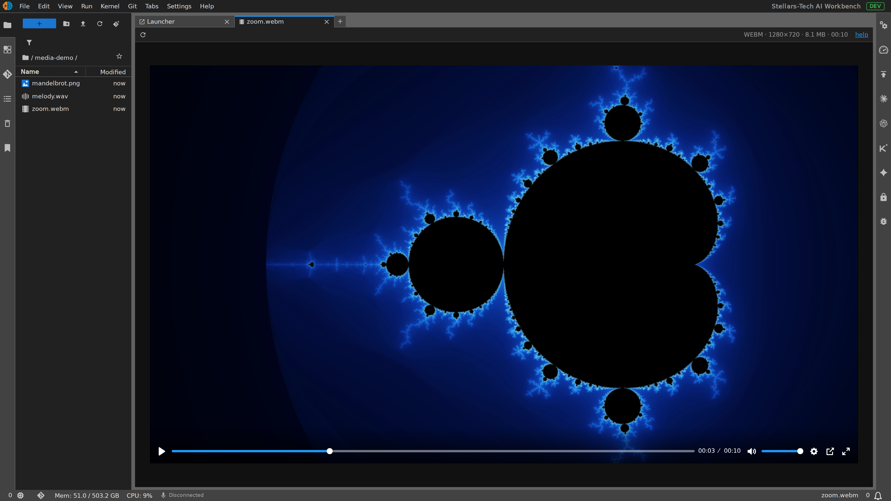

# jupyterlab_advanced_image_viewer_extension

[](https://github.com/stellarshenson/jupyterlab_advanced_image_viewer_extension/actions/workflows/build.yml)
[](https://www.npmjs.com/package/@stellarshenson/jupyterlab-advanced-image-viewer-extension)
[](https://pypi.org/project/jupyterlab-advanced-image-viewer-extension/)
[](https://pepy.tech/project/jupyterlab-advanced-image-viewer-extension)
[](https://jupyterlab.readthedocs.io/en/stable/)
[](https://kolomolo.com)
[](https://www.paypal.com/donate/?hosted_button_id=B4KPBJDLLXTSA)

A JupyterLab 4 extension that makes the built-in image viewer interactive and adds audio and video viewers. Images open fitted to the panel just like the stock viewer, then you can zoom with the wheel, pan by dragging, and step through a folder of images with the arrow keys - all in a single viewer tab.



The viewer toolbar adds zoom in / out / fit controls and a `help` link that lists every keybinding.

## Features

- **Fit to screen** - every image opens scaled to fit the panel (same result as the stock viewer), and reset returns to that fit
- **Wheel zoom** - scroll to zoom in and out, anchored at the cursor; zoom out as far as you like
- **Drag to pan** - hold and drag to move the image at any zoom; the image can touch a viewport border but never leave it, the grab cursor is always available, and Fit recenters
- **Toolbar controls** - zoom in, zoom out, and reset-to-fit buttons on the viewer toolbar
- **Arrow-key navigation** - Left and Right open the previous and next image in the same folder, in the order the file browser lists them, advancing within one viewer instead of opening new tabs
- **Copy to clipboard** - right-click a raster image (PNG/JPG/…) and choose "Copy to Clipboard" to copy it as PNG to the system clipboard
- **Refresh** - a toolbar refresh button reloads the image from disk, the same control the HTML viewer provides
- **WebP and AVIF support** - `.webp` and `.avif` files open in the image viewer with every feature above; stock JupyterLab does not open them and shows a File Load Error

## Audio and video viewers

Audio files open in a waveform player built on wavesurfer.js and video files in a Plyr player. The extension disables the stock JupyterLab audio and video viewers, so a double click on a media file opens these instead.




- **Audio controls** - play/pause, back and forward 5 s, Loop, a speed choice of 0.5x to 2x, waveform zoom with - / + / Fit, an overview strip that seeks anywhere in the file, the time under the mouse, and a drag-marked loop region of at least 1 s
- **Video controls** - play/pause, a seek bar, the current time, mute and volume, a speed menu, picture in picture and full screen, in a player fitted to the panel with the aspect ratio kept
- **Keys in a focused media tab** - Space plays and pauses, Left and Right seek 5 s, and Page Up / Page Down open the previous and next file of the same kind in the folder, in the order the file browser lists them (the folder navigation setting turns this off)
- **Help dialog** - a `help` link in each media toolbar lists the keys and the waveform gestures
- **File details** - the toolbar shows the format, the size and the duration, plus the channel count for audio and the frame size for video
- **100 MB limit** - a file up to 100 MB is downloaded once from its file URL and played from that copy, so seeking works on a server without byte ranges; above 100 MB the audio waveform is skipped and either file plays from its URL, so seeking there needs a server that serves byte ranges

## Requirements

- JupyterLab >= 4.6

## Install

To install the extension, execute:

```bash
pip install jupyterlab_advanced_image_viewer_extension
```

## Uninstall

To remove the extension, execute:

```bash
pip uninstall jupyterlab_advanced_image_viewer_extension
```
